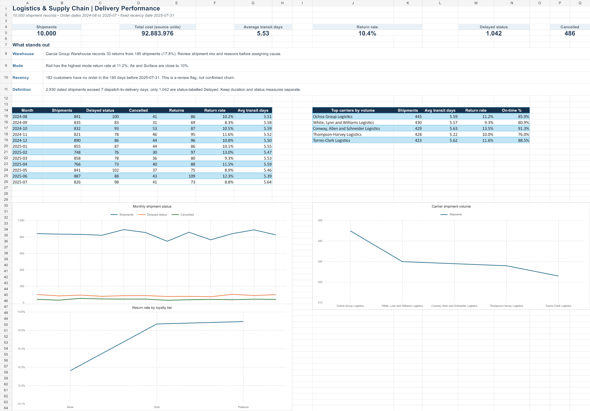

# Logistics & Supply Chain Delivery Performance

An operational review of 10,000 shipments recorded from August 2024 through July 2025. The analysis follows the same cleaned shipment data through Excel, SQLite, and a Power BI model specification.



## Findings at a glance

- Recorded shipment cost totals **92.88 million source currency units**. The source file does not specify a currency.
- The overall return rate is **10.41%**. Average dispatch-to-delivery time is **5.53 days** (median 6) for 9,514 shipments with a delivery date.
- **1,042** shipments carry the `Delayed` status; **486** are cancelled. Every cancelled shipment has a blank delivery date.
- Rail has the highest return rate among the three modes at **11.15%**, compared with **10.04%** for Air and **10.08%** for Surface.
- Garcia Group Warehouse has the highest observed warehouse return rate at **17.84%** (33 returns from 185 shipments). This points to a review area, not a proven cause.
- The return rate moved from **10.23%** in the prior six order months to **10.60%** in the latest six. Cancellations fell from 259 to 227 over those periods.

The source's `Delivery_Status` and elapsed delivery duration do not agree consistently. **2,930** dated shipments took more than seven days after dispatch, including **2,627** labelled `Delivered`. The dataset does not provide a promised delivery date or define the status rule, so the project reports the two measures separately.

## Contents

| Path | Description |
| --- | --- |
| [Excel analysis](outputs/01a201f0-580a-7f20-b78c-69665c732e97/Logistics_Supply_Chain_Analysis.xlsx) | Summary dashboard, monthly trend, regional and carrier comparisons, customer rankings, data-quality review, and shipment detail |
| `data/` | Prepared `Customers`, `Warehouses`, `Carriers`, and `Shipments` CSVs shared across the analyses |
| `analysis/` | Segment results, exception lists, customer rankings, and saved SQL query outputs |
| [SQLite database](logistics_analysis.db) | Query-ready tables with primary and foreign keys |
| [SQL analysis](SQL_Analysis.sql) | Business questions, cross-tool checks, and carrier efficiency calculation |
| [Power BI implementation pack](PowerBI_Implementation_Pack.md) | Star schema, Power Query guidance, DAX measures, and suggested report pages |
| [Executive summary](Executive_Summary_and_Business_Questions.md) | Business answers, limitations, and recommendations |
| `build_project.py` | Recreates clean CSVs, analysis tables, and the SQLite database from the supplied source workbook |
| `build_workbook.mjs` | Generates the formatted Excel workbook in the Artifact Tool runtime |

## Data model and definitions

`Shipments` is the fact table at one row per `Shipment_ID`. It joins to `Customers`, `Warehouses`, and `Carriers` by their IDs. No duplicate shipment IDs were found, and all shipment keys match a dimension record.

- `Dispatch_to_Delivery_Days` is elapsed calendar days between dispatch and delivery. Cancelled shipments remain blank.
- The fixed customer recency date is **2025-07-31**, the latest order date in the source. This keeps 30-day and 180-day flags stable across refreshes.
- Return rate is returns divided by all shipments in the segment, including cancellations.
- Overall cost per kilogram is total cost divided by total weight. It is a weighted rate.
- Carrier `Mode_Speciality` is descriptive; it does not mean the carrier only handles that mode.
- The source is a synthetic practice dataset. Customer email and phone fields are excluded from the prepared extracts.

## Rebuild and query

The preparation script expects the original workbook at `C:\Users\omsri\Downloads\Logistics_SupplyChain_Analysis_Ready.xlsx`. It requires Python and `openpyxl`:

```powershell
python -m pip install openpyxl
python build_project.py
python export_sql_results.py
```

Open `logistics_analysis.db` in SQLite and run `SQL_Analysis.sql` to reproduce the SQL results. The matching result tables are saved under `analysis/SQL_Query_Results/`.

The completed Excel file is included above. `build_workbook.mjs` was run with the OpenAI Artifact Tool runtime; that runtime is not bundled with this repository. A Power BI `.pbix` is not included. The implementation pack provides the data model and measures for building the interactive report in Power BI Desktop.

## Limitations

The source does not specify cost currency, promised delivery dates, return reasons, route IDs, or the calculation period for the carrier on-time percentage. The carrier efficiency score in the SQL file is a relative ranking with equal weight on reported on-time percentage and inverse min-max normalized carrier cost per kilometer. Warehouse, carrier, and regional comparisons are descriptive and do not establish causation.
